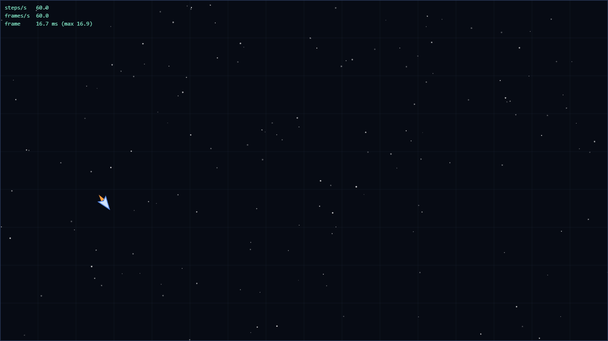
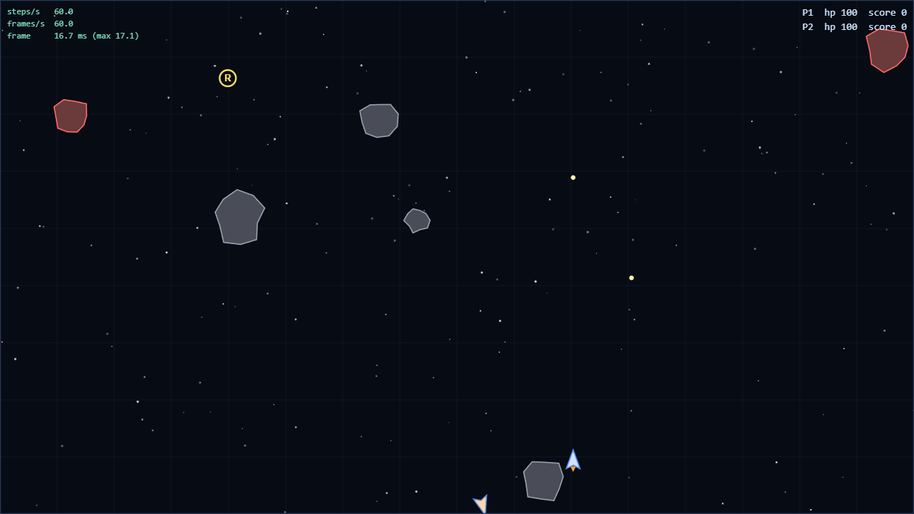
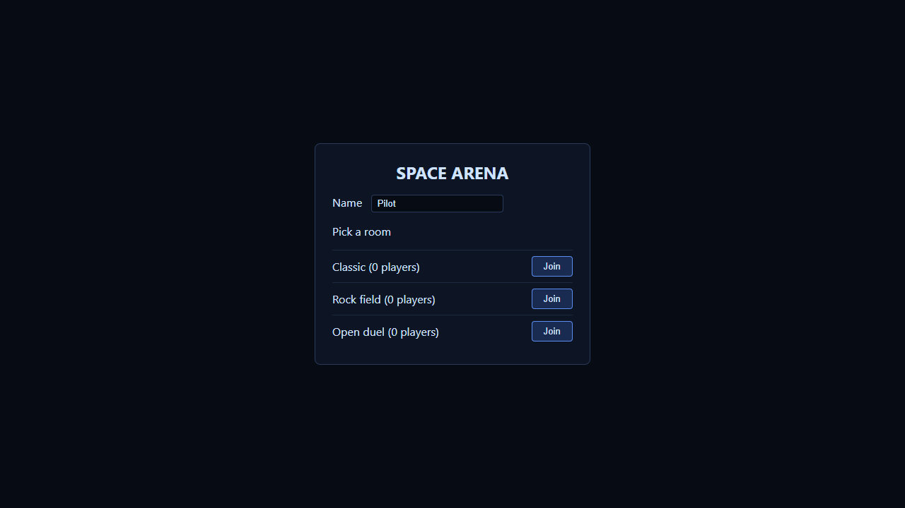
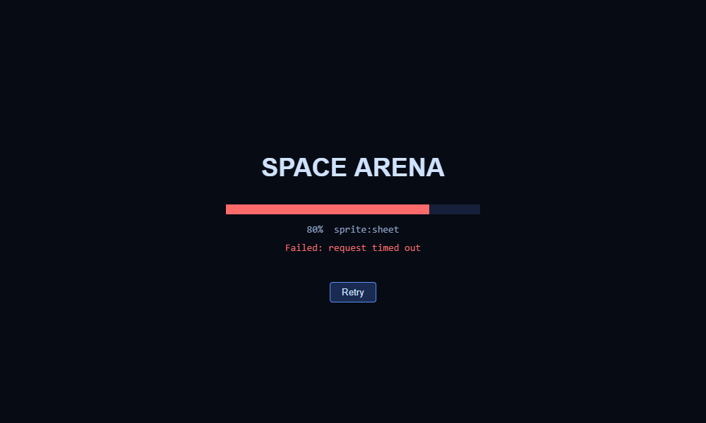
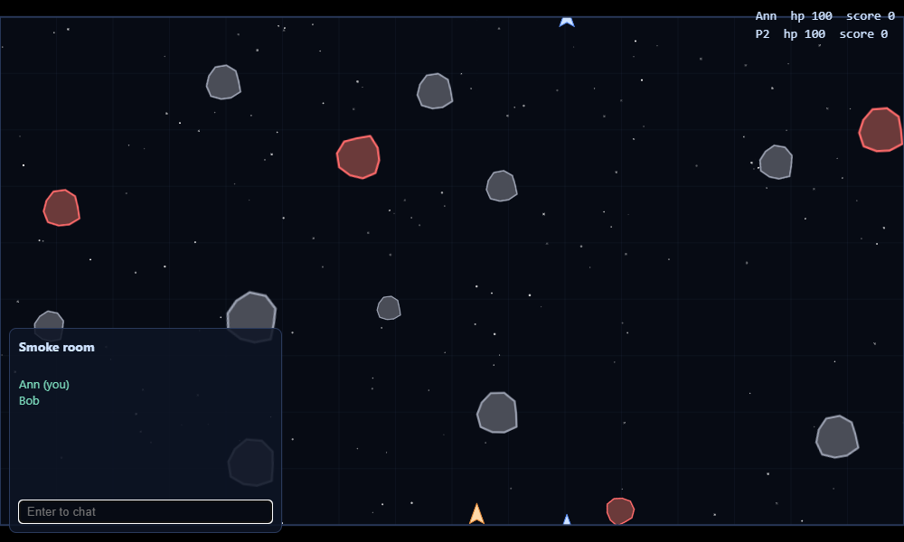
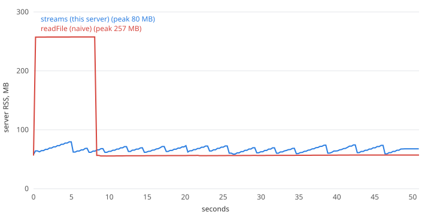
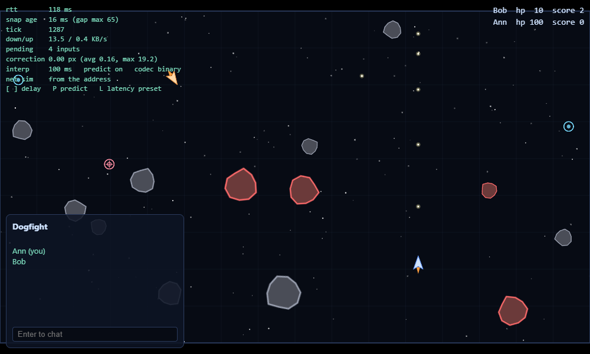
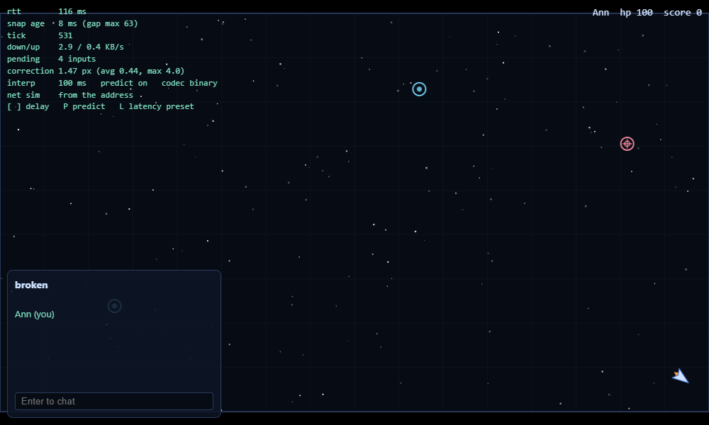

# Space Arena

Браузерна гра в реальному часі: клієнт на canvas, пізніше сервер на Node.js. Кожна лаба курсу
додає один крок. Нижче розділи по лабах, у кінці кожного числа й записи, які вимагає лаба.

- лаба 1: ігровий цикл, введення, корабель, три експерименти
- лаба 2: сутності, World, зіткнення, кулі, композиція (розділ "Лаба 2")
- лаба 3: завантаження ресурсів, спрайти й звук, лобі по HTTP (розділ "Лаба 3")
- лаба 4: сервер на Node без фреймворків: HTTP, WebSocket, потоки, логи, вимкнення (розділ "Лаба 4")
- лаба 5: авторитетний сервер 30 Гц, передбачення, інтерполяція, бінарний протокол (розділ "Лаба 5")
- лаба 6: увесь код на TypeScript, протокол описаний один раз (zod), типи замість перевірок (розділ "Лаба 6")



## Запуск

Три пакети в npm workspaces: `shared` (симуляція й протокол, однаковий код для клієнта й сервера),
`client` (Vite) і `server` (Node + `ws`).

```
nvm use               # Node 24, див. .nvmrc
npm install
npm run dev:server    # http://127.0.0.1:3000, логи матчів у server/logs
npm run dev:client    # Vite, проксі /api і /ws на сервер (BACKEND=host:port змінює адресу)
npm test              # node --test, три пакети
npm run typecheck     # tsc --noEmit у трьох пакетах
npm run lint          # Biome
npm run build         # client/dist
npm start             # сервер віддає client/dist і API на одному порту
```

Налаштування сервера через змінні середовища (читаються при старті, помилки показуються всі
разом, код виходу 2): `PORT`, `HOST`, `LOG_DIR`, `CLIENT_DIR`, `MAX_ROOMS`, `MAX_PLAYERS`,
`MAX_MESSAGE_BYTES`, `MAX_BODY_BYTES`, `RATE_LIMIT_PER_SEC`, `BUFFERED_LIMIT`,
`JOIN_TIMEOUT_MS`, `PING_INTERVAL_MS`, `STALE_ROOM_MS`, `ENABLE_SLOW`, `SLOW_MS`,
`INPUT_RATE_PER_SEC`, `MAX_INPUT_QUEUE`, `ENABLE_NETSIM`. Файл `server/.env` підхоплюється, якщо
є; для лаби 5 у ньому має бути `ENABLE_NETSIM=1` (інжектор затримки, див. нижче).

Керування: гравець 1 стрілки і Space, гравець 2 WASD і F (обидва на одній клавіатурі).
У лівому верхньому куті HUD: steps/s, frames/s, час кадру (середній і максимум за 0,5 с),
у правому верхньому hp і рахунок.

## Структура

З лаби 5 симуляція живе в `shared/src/sim/` (вона переїхала з `client/src/sim/`, назви файлів ті
самі: vector, entity, entities, behaviors, world, collision, rules, ship, game, arena, random).
Так що в списку нижче `client/src/sim/...` читати як `shared/src/sim/...`. Нове в лабі 5 описано в
розділі "Лаба 5" нижче. З лаби 6 усі файли в `src/` мають розширення `.ts` (імена ті самі, у списку
й нижче ще стоїть `.js`); тести лишились `.js`.

```
client/index.html
client/src/main.js            зв'язує все разом, HUD, перемикачі експериментів
client/src/loop.js            createLoop: rAF + акумулятор, фіксований крок 1/60 с
client/src/stats.js           лічильники steps/s, frames/s, час кадру
client/src/input.js           createInput: клавіатура в замиканні, ігнорує поля вводу
client/src/sim/vector.js      Vector2: чисті методи, об'єкт заморожений
client/src/sim/entity.js      Entity: id (#id), pos, vel, radius, kind, update
client/src/sim/ship.js        Ship extends Entity: #hp, get hp(), fire()
client/src/sim/entities.js    Bullet, Asteroid, Particle, фабрики вибуху, астероїда, піккапа
client/src/sim/behaviors.js   homing як поведінка (композиція)
client/src/sim/world.js       World: Map<id, Entity>, spawn/despawn, sweep, ofKind
client/src/sim/collision.js   коло-коло, окрема система
client/src/sim/rules.js       що відбувається при зіткненні: шкода, піккап, вибух, рахунок
client/src/sim/game.js        збирає світ: кораблі, астероїди, піккапи
client/src/sim/arena.js       розмір арени, загортання координат
client/src/sim/random.js      детермінований генератор
client/src/assets/loader.js   fetchJson, postJson, loadImage, loadAudio, withRetry, loadAll
client/src/audio.js           AudioContext, відтворення, підписка на події світу
client/src/ui/loading.js      екран завантаження на canvas із прогрес-баром
client/src/ui/lobby-view.js   DOM лобі зі створенням кімнати, ui/hud.js рахунок, ui/chat-view.js чат
client/src/net/lobby.js       Lobby extends Bus<LobbyEvents>: refresh, create, join, leave
client/src/net/connection.js  Connection: WebSocket, черга, перепідключення, коди закриття
client/public/assets/         manifest.json, sprites.png, три .wav (scripts/gen-assets.mjs)
client/vite.config.js         проксі /api і /ws на сервер, dev-міддлвар /slow/<мс>/...
client/test/                  node --test: Vector2, World, this, правила, завантажувач, лобі, Connection
client/src/render/canvas.js   canvas з devicePixelRatio, масштаб під вікно
client/src/render/draw.js     малювання арени, зірок, корабля
client/src/render/interpolate.js  lerp, кут, координата через край арени
client/src/experiments.js     код для трьох експериментів нижче
server/src/index.js           createApp, createShutdown, installShutdown, main
server/src/config.js          змінні середовища, перевірка, заморожений конфіг
server/src/protocol.js        версія, коди закриття, validate(), конструктори повідомлень
server/src/http.js            маршрути: /health, /api/rooms, /api/replays, /api/slow, статика
server/src/static.js          безпечний шлях, потокова віддача файлів
server/src/ws.js              WebSocketServer, ліміти, token bucket, повільні клієнти, heartbeat
server/src/rooms.js           Room extends EventEmitter, RoomManager
server/src/log/matchlog.js    events.on -> Readable.from -> Transform -> файл (NDJSON)
server/src/log/replay.js      async-генератор по рядках логу
server/test/                  node --test: протокол, конфіг, кімнати, логи, інтеграція з ws-клієнтами
scripts/                      gen-assets, make-log, rss-test, blocking-demo, crash-demo
```

## Як влаштовано (лаба 1)

- `createLoop({ step, simulate, render })` віддає `start()` і `stop()`. Кожен кадр rAF додає час
  кадру в акумулятор (не більше 0,25 с) і викликає `simulate(1/60)` стільки разів, скільки
  вміщається. Залишок `alpha = accumulator / step` іде в `render(alpha)`, і корабель малюється
  між попереднім і поточним станом. На моніторі 144 Гц буде 60 кроків і 144 кадри за секунду.
- `createInput()` тримає `Set` натиснутих клавіш у замиканні, назовні тільки `isDown`,
  `justPressed`, `endStep`, `dispose`.
- `integrate` чиста: бере корабель, `input` з методом `isDown` і `dt`, повертає новий корабель.
  Поворот, тяга, опір, обмеження швидкості. Загортання окремо, в `arena.js`. (У лабі 2 ця
  функція стала методом `Ship.update`, фізика та сама.)
- Інтерполяція кута йде найкоротшим шляхом, а координата, що перескочила через край арени,
  інтерполюється через край, а не через усю арену. Біля краю корабель малюється двічі.
- Розмір canvas у фізичних пікселях = CSS-розмір * `devicePixelRatio`. Перевірив з DPR 2:
  1000x600 CSS дає 2000x1200 у `canvas.width/height`.

## Експерименти (лаба 1)

Усі вмикаються через адресу: `?exp=block`, `?exp=interval`, `?exp=variable`, додатково
`&burn=N` (зайва робота в кадрі) і `&scenario` (політ за сценарієм). Код у `src/experiments.js`.

Як мірив: у сторінці підміняв `stats.step` і `stats.frame`, рахував кроки та інтервали між кадрами.
Експерименти 1, 2 (передній план) і 3 в Chromium через Playwright, дисплей 60 Гц. Фоновий тест
в окремому справжньому Chrome (Playwright вкладки не ховає), дві вкладки, перша ховається
другою. Числа з одного прогону, не усереднені по багатьох.

Базовий прогін (10 с, звичайний цикл): 60,2 steps/s, 60,1 frames/s, кадр 16,67 мс
(p95 17,0, макс 17,2).

### 1. Блокуючий цикл: 100 мс busy-wait у render кожен 60-й кадр

12 с, `?exp=block`.

|                | steps/s | frames/s | середній кадр | p95  | макс  | кадрів довше 33 мс | макс кроків за кадр |
| -------------- | ------- | -------- | ------------- | ---- | ----- | ------------------ | ------------------- |
| без блокування | 60,2    | 60,1     | 16,67 мс      | 17,0 | 17,2  | 0                  | 2                   |
| з блокуванням  | 60,0    | 55,5     | 18,04 мс      | 17,0 | 100,3 | 11                 | 6                   |

Що сталося. JS однопотоковий, rAF-колбек виконується в головному потоці, а поки він на стеку,
event loop не може ні взяти наступний рендер, ні обробити клавішу чи таймер. Сто мілісекунд
пропали, наступний кадр прийшов через 100 мс, акумулятор отримав 0,1 с і за один кадр відпрацював
6 кроків підряд. Тому steps/s залишився 60: симуляція наздогнала час. А frames/s впав до 55,5,
бо кожні 59 нормальних кадрів по 16,7 мс і один на 100 мс дають ~1,08 с на 60 кадрів. Гравець
бачить фриз на 100 мс і стрибок корабля. Середній кадр сходиться: (59 * 16,7 + 100,3) / 60 = 18,06.

### 2. setInterval(frame, 16) замість requestAnimationFrame

Та сама логіка з акумулятором, відрізняється тільки чим цикл запускається. `?exp=interval`.

Передній план, 10 с:

|                   | rAF       | setInterval(16) |
| ----------------- | --------- | --------------- |
| steps/s           | 60,2      | 60,0            |
| frames/s          | 60,1      | 62,5            |
| середній кадр     | 16,67 мс  | 16,00 мс        |
| розкид кадру (sd) | 0,22      | 0,65            |
| мін-макс кадру    | 16,1-17,2 | 14,2-17,8       |

Вкладка прихована (10 с виміру після 11 с у фоні):

|          | rAF | setInterval(16) |
| -------- | --- | --------------- |
| frames/s | 0   | 1,2             |
| steps/s  | 0   | 15,1            |

Після повернення на вкладку (2 с):

|                           | rAF      | setInterval(16) |
| ------------------------- | -------- | --------------- |
| макс інтервал між кадрами | 22068 мс | 927 мс          |
| макс кроків за один кадр  | 15       | 15              |
| frames/s                  | 60,1     | 62,4            |

Що сталося. `setInterval` кладе таск у чергу таймерів кожні 16 мс незалежно від дисплея.
Дисплей 60 Гц, таймер 62,5 Гц: ~2,5 кадри на секунду малюються даремно, а момент виклику
плаває відносно vsync (sd втричі більший, мінімум 14,2 мс). rAF браузер викликає сам у
кроці рендерингу перед малюванням, рівно раз на vsync. У прихованій вкладці rAF не викликається
взагалі (0 кадрів, економія CPU), а таймери душаться приблизно до одного разу на секунду.
Тому з setInterval гра йшла на 15 кроків/с замість 60, тобто на чверть швидкості: кожен тик
приходив через ~1 с, а акумулятор обрізає кадр до 0,25 с, це 15 кроків. З rAF гра просто
стоїть, а після повернення перший кадр бачить розрив 22 с, обрізає до 0,25 с і робить 15
кроків, без спіралі смерті.

### 3. Змінний крок замість фіксованого

`?exp=variable`: без акумулятора, один крок за кадр з `dt` = час кадру. Щоб траєкторії можна було
порівняти, клавіші подаються за сценарієм у функції від часу симуляції, а не від годинника:
тяга 0-2 с і 3-4 с, поворот вправо 0,5-1,5 с, вліво 2,5-3,5 с, усього рівно 5 с симуляції.
У кожному кадрі `&burn=300000` (зайва робота, яка залежить від швидкості CPU). CPU сповільнено
в 6 разів через DevTools (`Emulation.setCPUThrottlingRate`). Дві повторні спроби для кожної комірки.
Відстань рахується до першого прогону фіксованого кроку (з урахуванням загортання арени).

| цикл          | CPU | кроків | середній dt | кінцева позиція | відстань від еталона |
| ------------- | --- | ------ | ----------- | --------------- | -------------------- |
| фіксований #1 | 1x  | 300    | 16,67 мс    | 1138,66; 195,08 | 0 (еталон)           |
| змінний #1    | 1x  | 301    | 16,61 мс    | 1139,61; 203,02 | 7,99 px              |
| фіксований #2 | 1x  | 300    | 16,67 мс    | 1138,66; 195,08 | 0                    |
| змінний #2    | 1x  | 302    | 16,56 мс    | 1139,05; 195,21 | 0,40 px              |
| фіксований #1 | 6x  | 300    | 16,67 мс    | 1138,66; 195,08 | 0                    |
| змінний #1    | 6x  | 28     | 178,57 мс   | 1011,23; 186,02 | 127,75 px            |
| фіксований #2 | 6x  | 300    | 16,67 мс    | 1138,66; 195,08 | 0                    |
| змінний #2    | 6x  | 30     | 166,67 мс   | 1071,71; 225,76 | 73,65 px             |

Що сталося. З фіксованим кроком у всіх чотирьох прогонах кінцева позиція збіглася до останнього
знака, хоч CPU був у 6 разів повільніший: повільний кадр просто дає більше кроків по 1/60 с.
Зі змінним кроком результат залежить від того, як лягли кадри: навіть без навантаження два
прогони розійшлися на 7,99 і 0,4 px, а на 6x кадри по ~170 мс і траєкторія пішла на 74-128 px.
Причини: інтегрування Ейлера дає різну похибку для різного `dt`, а натискання клавіш
читаються раз на кадр, тож момент увімкнення тяги з'їжджає на цілий кадр. Для мережевої гри це
критично: два клієнти з різним FPS отримали б різні світи. Після експерименту акумулятор
повернуто, у `createLoop` він є.

## Що не зроблено (лаба 1)

Stretch-завдання (Gamepad, дотик, гістограма кадрів, Web Worker) не робив.

## Лаба 2: сутності, прототипи, this



Два кораблі на одній клавіатурі, сірі астероїди (відбиваються від стін) і червоні астероїди-мисливці
(повільно наводяться на корабель). Кулі б'ють кораблі й астероїди. Знищений корабель вибухає
частинками і з'являється знову через 2 с у вільному місці з 2 с захисту. Піккапи стоять на місці:
S щит, R швидка стрільба, H самонавідні кулі (по 8 с). Рахунок: +10 за корабель, +2 за астероїд.

### Модель

- `Vector2` не мутує нічого: усі методи повертають новий вектор, сам об'єкт `Object.freeze`,
  тому `v.x += 1` кидає `TypeError` (є тест).
- `Entity` має `id` з приватного лічильника (`static #nextId`, `#id` + `get id()`), `pos`, `vel`,
  `angle`, `radius`, `kind`, `alive`, `update(dt)`. `Ship`, `Bullet`, `Asteroid`, `Particle`
  наслідують `Entity` напряму, глибше дерево не йде.
- `World` тримає `#entities: Map<id, Entity>`, ітерується через `*[Symbol.iterator]`, має генератор
  `*ofKind(kind)`. `despawn(id)` тільки ставить `alive = false`, а `sweep()` в кінці `step` справді
  видаляє. Нові сутності під час кроку (наприклад, респаун) чекають у черзі й потрапляють у Map
  після кроку, тому Map не змінюється під час обходу.
- Зіткнення: `collision.js` це генератор пар `[a, b]` (наївний O(n^2)), який нічого не вирішує.
  Що робити з парою, вирішує `rules.js`. Систему можна замінити на іншу з тим самим інтерфейсом.
- У корабля приватне `#hp`, `get hp()` і `takeDamage()`. Спроба `ship.hp = 1` кидає `TypeError` (є тест).
- Мутація чи копії: сутності мутуються на місці (як і в лабі 1), а `Vector2` незмінний. Тому
  `pos = pos.add(...)` кожен крок створює новий вектор, а знімок для інтерполяції `prevPos = pos`
  не потребує копіювання: старий вектор ніхто не змінить. Це трохи більше сміття для GC, зате
  немає класу багів з "хтось змінив спільний вектор". Якщо профіль покаже проблему, заміню гарячі
  місця на мутабельні варіанти.
- Таймери (респаун, нові астероїди, піккапи) рахуються в часі симуляції (`world.schedule`), а не
  через `setTimeout`, щоб світ лишався детермінованим: два світи з однаковим seed після 600 кроків
  однакові (тест).

### Баг із this

Спочатку кулю в слухачі клавіатури я передавав так, як хочеться написати:

```js
window.addEventListener("keydown", ship.fire); // не працює
```

У браузері кожне натискання дає `Cannot read properties of undefined (reading 'add')` (перевірив
у Chromium). Причина: `ship.fire` це просто функція, яка вже не знає про `ship`. Слухач викликає
її з `this === window` (перевірив: `this === window` дало `true`), у вікна немає `pos`, тому
`this.pos.add(...)` падає. При простому виклику `const f = ship.fire; f()` у модулі `this` це
`undefined`, і помилка інша: `reading 'cooldown'` (є в тесті). Метод, який бере `this`, працює
тільки як `ship.fire()`.

Три виправлення:

1. Стрілка-обгортка: `input.onPress(code, () => ship.fire())`. **Обрав це** (див. `main.js`).
   Мінус: анонімну функцію не зняти через `removeEventListener`, поки не збережеш посилання
   (у моєму `input.onPress` це вирішено: він повертає функцію відписки).
2. `ship.fire.bind(ship)`. Зв'язана функція не залежить від того, як її викличуть. Мінус: кожен
   `bind` створює нову функцію, її теж треба зберігати для `removeEventListener`, і `this`
   потім не змінити ні `call`, ні `apply`.
3. Стрілка як поле класу: `fire = () => {...}`. Працює скрізь, але тоді `fire` вже не на
   прототипі, а окрема функція на кожному екземплярі: на 1000 об'єктів 1000 копій у пам'яті,
   `super.fire()` не працює, а підклас не перевизначить метод.

Усі три варіанти (і сам баг) покриті в `test/this.test.js`.

### Консольні досліди

```
1. b.hello() before: hello from a | own property? false
1. b.hello() after changing a.hello: changed in a
2. inst.m() === inst: true
2. m(): undefined
2. m.call(inst) === inst: true
3. o[1]: x | Object.keys(o): [ '1' ]
3. map.get("1"): undefined | map.get(1): x
```

1. `Object.create(a)`: у `b` немає власного `hello`, пошук іде по прототипу, тому зміна в `a`
   одразу видна в `b`. Метод живе в одному місці, а не копіюється.
2. `const m = inst.m; m()` це простий виклик, `this` не прив'язаний (у strict mode `undefined`).
   `m.call(inst)` задає `this` явно. Те саме, що з `ship.fire`.
3. Ключі звичайного об'єкта завжди рядки: `1` став `"1"`. У `Map` ключ `1` і `"1"` різні.
   Ще в об'єкта є успадковані ключі (`({}).constructor` це функція), у `Map` нема.

### Дизайн: композиція замість ієрархії

Дві фічі не вкладаються в дерево класів: самонаведення (на кулі й на астероїді) і піккап
(стоїть, зіштовхується, не корабель).

**Як було б з наслідуванням.** `Entity` -> `Bullet` -> `HomingBullet`, `Entity` -> `Asteroid` ->
`HomingAsteroid`, `Entity` -> `Pickup` -> `ShieldPickup`, `RapidPickup`, `HomingPickup`. Код
самонаведення довелося б або скопіювати у два класи, або підняти в `Entity`, де він потрібен
далеко не всім (кораблю, частинці, піккапу), або робити спільного предка `Movable` між ними.
Кожна нова незалежна фіча подвоює кількість класів: самонавідна куля зі щитом, самонавідний
астероїд з TTL. JS має одиночне наслідування, тож другого батька не додати. Міксини
(`Homing(Bullet)`) вирішують це, але вишиковують ланцюжок прототипів, а порядок міксинів
ховає, чий `update` викликається першим. Це вже не "один рівень extends".

**Що вибрав.** Поведінка як дані + функції: у кожної `Entity` є `behaviors` (масив функцій
`(self, dt) => ...`, які `update` викликає до руху) і `parts` (звичайний об'єкт з даними).
`homing({ targetKinds, turnRate })` це одна функція, `withHoming(entity, opts)` чіпляє її до
будь-якої сутності: до кулі в `Ship.fire`, коли активний ефект H, і до астероїда у
`spawnAsteroid`. Тест `rules.test.js` перевіряє обидва випадки на одному коді.
Піккап це звичайна `Entity` з `kind: "pickup"` і `parts.pickup = { effect, seconds }`, без
підкласу. `rules.js` бачить зіткнення корабля з `pickup` і викликає `ship.applyEffect`.
Новий ефект це новий рядок у списку, а не новий клас.

**Ціна.** `behaviors` і `parts` гірші за методи: IDE їх не підказує, нічого не гарантує, що
`parts.pickup` має потрібну форму, порядок поведінок має значення, `kind` це рядок. Для цієї гри
це прийнятно. У лабі 6 з TypeScript форму `parts` можна описати типами.

### Що не зроблено (лаба 2)

Stretch (ECS на типізованих масивах, просторовий хеш, заміри `World.step` на 5000 сутностях)
не робив. Числових вимірів у лабі 2 немає.

## Лаба 3: асинхронний JavaScript



Тепер гра стартує так: екран завантаження (реальний прогрес) -> лобі (ім'я і кімната) -> гра зі
спрайтами й звуком. Ресурси (спрайт-лист і звуки) згенерував скрипт `scripts/gen-assets.mjs`,
щоб не залежати від чужих файлів. `?exp=...` і `?scenario` з лаби 1 стартують гру одразу, без
завантаження і лобі.

### Завантаження ресурсів

- `public/assets/manifest.json`: спрайт-лист із прямокутниками кадрів, три звуки, опис арен.
- `loader.js`: `fetchJson` перевіряє `response.ok` в одному місці (`fetch` не відхиляє промис на
  404/500), `loadJson`, `loadImage` (`fetch` -> `createImageBitmap`), `loadAudio(ctx, url)`
  (`decodeAudioData`). Усі приймають `AbortSignal`, у кожного запиту є таймаут через
  `AbortSignal.timeout` (8 с за замовчуванням).
- `withRetry(fn, { attempts, baseMs, signal })`: повторює лише тимчасові помилки (5xx, мережа,
  таймаут), ніколи 4xx, зламаний JSON чи файл, який не декодується. Пауза `baseMs * 2^(n-1)`,
  помножена на випадкове 0,5-1 (jitter). Взяв 3 спроби і `baseMs` 250 мс.
- `loadAll(manifest, { onProgress, signal })`: `Promise.all` по всіх ресурсах, прогрес
  `готово / усього` після кожного. Ресурс з `optional: true` може впасти (він потрапляє у
  `result.failed`), решта вантажиться. Якщо падає обов'язковий, решта запитів скасовується
  внутрішнім `AbortController`, щоб не лишати осиротілих запитів.
- Гра стартує тільки після `await loadAll(...)`. Звуки декодуються під час завантаження, а не
  при першому пострілі.

### Порівняння: послідовно проти одночасно

`?slow=200&inject=many`: кожен запит іде через dev-міддлвар із затримкою 200 мс, плюс 12 копій
звуку, разом 16 ресурсів і `manifest.json` перед ними. Час від початку до готовності, 3 прогони,
мілісекунди:

| режим                           | прогони          | середнє |
| ------------------------------- | ---------------- | ------- |
| `Promise.all` (одночасно)       | 877, 844, 844    | 855     |
| по черзі (`?loader=sequential`) | 3686, 3661, 3692 | 3680    |

Послідовно виходить 17 запитів по 200 мс = 3400 мс плюс декодування. Одночасно виходить не
200, а ~855 мс: Vite dev працює по HTTP/1.1, а браузер тримає до 6 з'єднань на хост, тож 16
ресурсів ідуть трьома хвилями по ~200 мс після `manifest.json`. Те саме перевіряє тест
`loadAll: progress is real...` на підробленому `fetch`.

### Звук і спрайти

Спрайти малюються через `drawImage` з прямокутниками з маніфесту (кораблі, астероїди звичайні
й червоні, три піккапи, дві кулі). Якщо спрайт-листа нема, `drawScene` малює векторні фігури з
лаби 2. `audio.js` володіє `AudioContext`, перший клік або клавіша робить `resume()` (браузер
тримає контекст призупиненим до жесту).

Симуляція не імпортує ні `audio.js`, ні `hud.js`: `World` шле події `fired`, `hit`, `exploded`,
`pickup`, `score`, `respawned` (в лабі 3 це був `EventTarget` з `CustomEvent`, з лаби 6 типізована
шина `Bus`, див. "Лаба 6"), а звук і HUD підписуються ззовні (`connectAudio`, `connectHud`). Є тест, який читає імпорти у `src/sim/*.js` і
падає, якщо там з'явиться audio, hud, ui чи loader.

### Лобі по HTTP

`Lobby` (спершу `extends EventTarget`, тепер `extends Bus`; `refresh()`, `join(roomId, name)`,
`leave()`, події `rooms`, `error`, `joined`) нічого не знає про DOM, а `lobby-view.js` лише слухає події й малює.
Кімнати приходять з `/api/rooms` (у лабі 3 це був dev-міддлвар із файлом `rooms.json`, у лабі 4
його замінив справжній сервер). Оновлення раз на 3 с, поки лобі видно, кожен запит із таймаутом 2,5 с через
`AbortSignal.timeout`, запити не накладаються. `leave()` зупиняє таймер і скасовує запит, який
ще летить: тест перевіряє, що після `leave()` сигнал запиту `aborted` і подій нема. Join
запускає локальну гру з налаштуваннями арени кімнати (кількість астероїдів, піккапи).

Помилку лобі я побачив на собі: спершу `/api/rooms` віддавав HTML, бо Vite на шлях без
розширення повертає `index.html`. Лобі показало "Cannot load rooms: Unexpected token '<'..." і
продовжило пробувати, не впало.

### П'ять головоломок

Кожну запустив, виводи справжні.

**1.** `await` і мікрозадачі:

```js
async function f() {
  log("a");
  await null;
  log("b");
}
log("1");
f();
Promise.resolve().then(() => log("c"));
log("2");
```
Вивід: `1, a, 2, b, c`. `f()` біжить синхронно до першого `await` (тому `a` раніше за `2`), а
продовження після `await` стає мікрозадачею раніше, ніж `.then(c)`.

**2.** `setTimeout` усередині `.then`:

```js
setTimeout(() => log("timeout 1"), 0);
Promise.resolve()
  .then(() => {
    log("then 1");
    setTimeout(() => log("timeout 2"), 0);
  })
  .then(() => log("then 2"));
log("sync");
```
Вивід: `sync, then 1, then 2, timeout 1, timeout 2`. Усі мікрозадачі виконуються до наступної
таски, тож обидва `then` раніше за будь-який таймер. Таймери йдуть у порядку створення.

**3.** `requestAnimationFrame` (у Chromium, 20 прогонів з 20 однаково):

```js
requestAnimationFrame(() => log("raf"));
setTimeout(() => log("timeout"), 0);
Promise.resolve().then(() => log("microtask"));
log("sync");
```
Вивід: `sync, microtask, timeout, raf`. Мікрозадача після синхронного коду, таймер це окрема таска,
а rAF-колбек іде в кроці рендерингу перед малюванням, тобто пізніше. Це не гарантія: якщо
кадр випаде раніше за таймер, порядок буде іншим. Я лише виміряв, що в цьому браузері так.

**4.** Уже виконаний промис, `await` і `queueMicrotask`:

```js
const p = new Promise((resolve) => {
  log("executor");
  resolve("v");
});
p.then(() => log("then"));
(async () => {
  log("async start");
  await p;
  log("async resumed");
})();
queueMicrotask(() => log("queueMicrotask"));
log("end");
```
Вивід: `executor, async start, end, then, async resumed, queueMicrotask`. Executor біжить
синхронно. Далі черга мікрозадач просто йде в порядку додавання: `.then`, продовження після
`await p`, `queueMicrotask`.

**5.** `finally` і зайві такти:

```js
Promise.reject(new Error("x"))
  .catch(() => log("caught"))
  .finally(() => log("finally"))
  .then(() => log("after"));
Promise.resolve()
  .then(() => log("p1"))
  .then(() => log("p2"))
  .then(() => log("p3"))
  .then(() => log("p4"));
log("sync");
```
Вивід: `sync, caught, p1, finally, p2, p3, p4, after`. Обидва ланцюжки ідуть по одному такту
по черзі, але `finally` повертає новий промис, і `.then(after)` чекає ще кілька тактів,
тому `after` приходить після `p4`, хоча стоїть у коді раніше за ланцюжок p1-p4.

### Галерея збоїв

Кожен випадок відтворюється через адресу. Логи з `window.__loadLog`.

| випадок                     | адреса                         | що в логу                                                                                                                             | що бачить гравець                                                               |
| --------------------------- | ------------------------------ | ------------------------------------------------------------------------------------------------------------------------------------- | ------------------------------------------------------------------------------- |
| 404 спрайт (необов'язковий) | `?inject=missing`              | `loaded in 20 ms, optional failures: sprite:ghost (HTTP 404 for /assets/ghost.png)`                                                   | гра стартує, лобі є, спрайта нема. 404 не повторюється                          |
| таймаут                     | `?inject=timeout&timeout=1500` | `retry sound:stuck: attempt 1 failed (TimeoutError), next in 159 ms`, `... attempt 2 ... next in 489 ms`, `Failed: request timed out` | через 5,5 с екран з червоною смугою на 80%, "Failed: request timed out" і Retry |
| abort посеред завантаження  | `?slow=1500`, Esc              | `Loading cancelled`                                                                                                                   | екран "Loading cancelled" і Retry                                               |
| зламаний JSON               | `?inject=corrupt`              | `Failed: broken JSON (Unexpected end of JSON input)`, без повторів                                                                    | екран із помилкою і Retry                                                       |



Зламаний JSON не повторюється, бо `SyntaxError` не тимчасова помилка: той самий файл буде зламаним
і вдруге. Для таймауту з'являється 2 повтори (з 3 спроб) з паузами в межах jitter. Retry
перевірив на abort: `?slow=400`, Esc, Retry, і завантаження успішно доходить до лобі (в логу
`Loading cancelled`, потім `loaded in 822 ms`). У випадках, де ресурс зламаний навмисно, Retry
знову впаде, там я перевіряв лише появу кнопки.

Перший прогін "404" показав, що це не 404: Vite dev віддає `index.html` зі статусом 200 на
невідомий шлях, `ok === true`, і помилка була "The source image could not be decoded".
Виправив тим, що `loadImage` і `loadAudio` шлють `Accept: image/*` і `audio/*`, тоді Vite
чесно відповідає 404.

### Що не зроблено (лаба 3)

Stretch (потоковий прогрес за `Content-Length`, пріоритетний завантажувач, власний `Promise.all`)
не робив. П'ять консольних дослідів з тексту лаби (`fetch` на 404, `AbortController`,
необроблений reject тощо) окремо не робив і в README не виписував: у звіт пішли таймінг,
головоломки й галерея збоїв, а `fetch` на 404 і abort покриті тестами в `test/loader.test.js`.

## Лаба 4: сервер на Node.js

Сервер без фреймворків: `node:http` + бібліотека `ws`. Робить три речі: віддає статику й API,
тримає кімнати з чатом по WebSocket, пише журнал кожної кімнати у файл. Сама гра поки що
крутиться в клієнті локально (синхронізація буде в лабі 5), кімната дає список гравців і чат.



### Маршрути

| маршрут                   | що робить                                                               |
| ------------------------- | ----------------------------------------------------------------------- |
| `GET /health`             | `status`, `uptimeSec`, `rss`, `rooms`, `connections`, `droppedMessages` |
| `GET /api/rooms`          | список кімнат `{ id, name, arena, players }`                            |
| `POST /api/rooms`         | створити `{ name, arena }`: 201, 400 (форма), 413 (тіло), 429 (ліміт)   |
| `GET /api/replays`        | імена файлів логів                                                      |
| `GET /api/replays/<name>` | журнал кімнати потоком (`application/x-ndjson`)                         |
| `GET /api/slow`           | тільки з `ENABLE_SLOW=1`: busy-loop на `SLOW_MS`, для демо блокування   |
| все інше `GET`/`HEAD`     | статика з `client/dist` (потоком, шлях перевіряється)                   |

### Протокол WebSocket (`/ws`, версія 1, лише текстові JSON-кадри)

Клієнт першим повідомленням шле `{ type: "join", v: 1, room, name }`, далі `{ type: "chat", text }`.
Сервер відповідає `welcome` (id, кімната, гравці), розсилає `roster` при кожному вході/виході й
`chat` `{ from, text, t }` усім у кімнаті, включно з відправником. Кожен вхідний кадр проходить
`validate()`, яка повертає результат, а не кидає виняток; зайві поля в повідомленні
відхиляються. Порушення закривають сокет кодом:

| код  | коли                                                           |
| ---- | -------------------------------------------------------------- |
| 1001 | сервер вимикається                                             |
| 1009 | кадр більший за `MAX_MESSAGE_BYTES` (4096), це робить `ws`     |
| 4400 | не JSON, не та форма, бінарний кадр, чат до join, другий join  |
| 4401 | невідомий `type`                                               |
| 4402 | `v` не дорівнює 1                                              |
| 4404 | кімнати нема                                                   |
| 4408 | не було join за `JOIN_TIMEOUT_MS` (5 с)                        |
| 4409 | кімната повна (`MAX_PLAYERS`, 8)                               |
| 4413 | клієнт читає так повільно, що буфер перевищив ліміт у 16 разів |
| 4429 | більше `RATE_LIMIT_PER_SEC` повідомлень на секунду (20)        |

Значення кодів 44xx і цифри лімітів я вибрав сам: лаба їх не задає. Клієнт (`Connection`)
після будь-якого закриття, крім 4400, 4401, 4402, 4404, 4409, 4429, перепідключається з
експоненційною паузою (500 мс * 2^спроба, не більше 10 с, jitter 50-100%) і знову шле `join`;
повідомлення, надіслані поки сокет закритий, стоять у черзі й підуть після `join`. На ці
шість кодів повторювати марно: сервер відмовив з причини, яка сама не зникне.

### Ліміти

| що                       | значення                                                  | де спрацьовує                          |
| ------------------------ | --------------------------------------------------------- | -------------------------------------- |
| розмір WS-кадру          | 4096 байт                                                 | `maxPayload` у `ws`, закриття 1009     |
| тіло `POST`              | 1024 байти                                                | `readBody`, відповідь 413              |
| кімнат                   | 20                                                        | `RoomManager.create`, відповідь 429    |
| гравців у кімнаті        | 8                                                         | `Room.join`, закриття 4409             |
| повідомлень на секунду   | 20 (token bucket, запас 20)                               | закриття 4429                          |
| буфер повільного клієнта | 64 КіБ                                                    | чат відкидається, 16 * ліміт: закриття |
| порожня кімната          | видаляється одразу, а якщо ніхто не зайшов, то через 60 с | таймер без `ref`                       |

### Потоки, backpressure і пам'ять

Журнал кімнати це файл NDJSON. Конвеєр: події кімнати (`events.on(room, "event", { close:
["empty"] })`) -> `Readable.from` -> `Transform` у режимі об'єктів, що робить рядок JSON ->
`createWriteStream`, усе через `stream/promises.pipeline`. Файл читається так само потоками:
`/api/replays/<name>` це `pipeline(createReadStream, res)`, а `replay(file)` це async-генератор
по `readline`. Жодне місце не читає файл цілком.

Перевірка (`node scripts/rss-test.mjs`): файл 200 МБ, клієнт качає його повільно (пауза після
кожного шматка), раз на 250 мс читається RSS сервера. Другий учасник: `scripts/naive-server.mjs`,
де `readFile` читає весь файл у пам'ять перед відправкою.



| сервер               | RSS на старті | пік RSS | завантажено |
| -------------------- | ------------- | ------- | ----------- |
| потоки (цей сервер)  | 58 МБ         | 80 МБ   | 200 МБ      |
| `readFile` (наївний) | 56 МБ         | 257 МБ  | 200 МБ      |

Потоковий сервер піднімає RSS на ~22 МБ незалежно від розміру файлу, а наївний на ~200 МБ, тобто
на розмір файлу. Механізм: `res` не приймає нові шматки, поки клієнт не вичитав попередні, `pipe`
ставить `createReadStream` на паузу, і диск не читається швидше, ніж іде мережа. Це і є
backpressure; при `readFile` ніякої паузи нема, бо весь файл уже в пам'яті. Швидкість клієнта я
хотів 10 МБ/с, але на Windows `setTimeout` не чекає менше ~15 мс, і реально вийшло ~4 МБ/с (кожен
прогін близько 50 с). Вимір один раз на кожен сервер, не усереднений.

### Один потік: що робить синхронний обробник

`node scripts/blocking-demo.mjs`: сервер з `ENABLE_SLOW=1`, `/api/slow` крутить цикл 300 мс.
Один клієнт у кімнаті шле чат кожні 100 мс і міряє, за скільки повідомлення повертається, а
інший тричі викликає `/api/slow`.

| стан сервера         | повідомлень | медіана | максимум |
| -------------------- | ----------- | ------- | -------- |
| простій              | 13          | 0,6 мс  | 0,8 мс   |
| йдуть виклики `slow` | 17          | 0,8 мс  | 284,9 мс |

Медіана майже не змінилась, бо більшість проб потрапила в паузи між викликами. Максимум показує
суть: повідомлення, яке прийшло під час циклу, чекає його кінця (~285 мс), бо event loop один, і
поки виконується синхронний код, нічого більше не читається й не пишеться: ні чат, ні `/health`,
ні pong для heartbeat. Тому в сервері немає синхронного I/O (`stat`, `readdir`, `readFile`
скрізь `fs/promises` або потоки), а `/api/slow` вимкнений без `ENABLE_SLOW`.

### Що ламає процес і чому в сервері є слухачі помилок

`node scripts/crash-demo.mjs`, вивід (скорочено):

```
--- 1. 'error' event with no listener
exit code: 1
socket.emit("error", new Error("ECONNRESET: peer went away"));
Error: ECONNRESET: peer went away
--- 1b. the same, with a listener
exit code: 0
handled: ECONNRESET: peer went away
--- 2. rejected promise nobody awaits
exit code: 1
async function handler() { throw new Error("bad message"); }
Error: bad message
--- 2b. the same, with .catch
exit code: 0
handled: bad message
```

`EventEmitter`, який емітить `error` без слухача, кидає виняток, а непіймана помилка в Node
завершує процес: один обірваний сокет поклав би сервер для всіх. Тому слухач `error` стоїть на
`WebSocketServer`, на кожному сокеті й на `http.Server`. Те саме з відхиленим промісом: обробник
HTTP запускається як `handle(req, res).catch(...)`, і HTTP-помилка стає відповіддю 4xx, а решта
відповіддю 500 з записом у лог.

### Вимкнення

`SIGINT` і `SIGTERM` запускають `app.close()`: перестати приймати нові з'єднання, закрити кожен
сокет кодом 1001, дочекатись їх (до 1 с, далі `terminate`), закрити кімнати, дочекатись запису
логів і вийти з кодом 0. Помилка при вимкненні дає код 1. Конфіг з помилками дає код 2 і
перелік усіх проблем одразу.

### Тести

71 тест у `npm test` (було 35 до лаби): протокол (`validate`, межі, коди), конфіг, кімнати,
token bucket, політика повільного клієнта на фальшивому сокеті, `resolveStaticPath` (шляхи з
`..`, `%2e%2e`, `\`, NUL), журнал і `replay`, `Connection` на фальшивому WebSocket (черга, join
першим, перепідключення, фатальні коди), і інтеграційні тести з реальним сервером на вільному
порту та клієнтами `ws`: join/чат/roster, усі коди закриття, `autoPong: false` для heartbeat,
413, 429, потокова віддача логу, вимкнення. Шлях з `..` у запиті `fetch` не перевірити, бо
`fetch` прибирає `..` сам, тому ці запити йдуть сирим `http.get`.

Тест знайшов реальну помилку: `new URL(req.url)` прибирає `..` ще до перевірки шляху, і
захист ніколи не бачив спроби. Тепер `serveStatic` бере сирий шлях із `req.url`. Ручна перевірка
у двох вікнах браузера теж знайшла помилку: лобі кожні 3 с перебудовувало весь список, кнопка
Join зникала з-під курсора посеред кліку. Тепер рядки оновлюються за id кімнати.

### Що не зроблено (лаба 4)

- Автоматичного тесту на справжній сигнал нема. `createShutdown` перевірено з підміненим
  `exit`, але зв'язка `process.once("SIGTERM")` перевірена лише читанням коду: на Windows
  `child.kill("SIGTERM")` просто вбиває процес без обробника.
- Хостингу й публічної адреси нема, усе перевірено на localhost.
- Перепідключення в браузері руками не дивився (сервер не рвав), воно покрите тестом на
  фальшивому сокеті.

## Лаба 5: авторитетний сервер, передбачення, бінарний протокол



Тепер після лобі гра йде на сервері. Клієнт шле лише натиснуті клавіші, сервер крутить
симуляцію 30 разів на секунду й розсилає знімки світу. Свій корабель клієнт передбачає сам, чужі
малює з невеликим запізненням. `?local` в адресі запускає стару локальну гру з лаби 4.

### Що де лежить

```
shared/src/sim/            симуляція з клієнта: без DOM, без Node API, без Math.random і Date.now
shared/src/sim/dmath.js    власні sin, cos, atan2 (див. "Баг детермінізму")
shared/src/sim/match.js    createMatch, applyCommand, TICK_RATE 30
shared/src/sim/snapshot.js знімок світу простими даними (id, x, y, кут...)
shared/src/sim/replay.js   сценарій з N кроків і хеш стану (тест детермінізму)
shared/src/protocol.js     типи повідомлень, версія 1
shared/src/codec/          binary.js (DataView, специфікація в коментарі зверху), json.js
server/src/match.js        Match: тік 30 Гц, черга входів на гравця, знімки, статистика
server/src/netsim.js       інжектор затримки: затримка, jitter, втрати
client/src/net/predict.js  передбачення, відновлення, згладжування
client/src/net/interp.js   буфер інтерполяції чужих сутностей
client/src/net/netgraph.js лічильники й текст оверлея
client/src/net/play.js     склеює все в онлайн-гру
scripts/bot.mjs            скриптований гравець для другого корабля
scripts/codec-bench.mjs    JSON проти бінарного
scripts/timer-jitter.mjs   setInterval проти абсолютної цілі
```

Керування в онлайн-грі те саме (стрілки/WASD, Space/F). Ще: `[` і `]` міняють затримку
інтерполяції на 16 мс, `P` вмикає й вимикає передбачення, `L` перемикає пресети затримки
(вимкнено, 100 мс ±30 і 2% втрат, 200 мс ±50 і 5% втрат; працює тільки з `ENABLE_NETSIM=1`).
Адреса: `?lat=100&jitter=30&drop=2` вмикає інжектор з початку, `?delay=100` затримка
інтерполяції, `?predict=0` вимикає передбачення, `?codec=json` JSON замість бінарного,
`?breakdet=0.2` навмисно ламає детермінізм (див. нижче).

### Сервер

- `Match` на кімнату: `World.step` 30 разів на секунду. Таймер не `setInterval`, а `setTimeout`
  на абсолютну ціль (`start + n * 33,3 мс`), тому похибка одного тіку не накопичується. Таймер
  `unref`, щоб не тримав процес.
- Один вхід `{ seq, left, right, thrust, fire }` споживається за один тік. Якщо в клієнта
  накопичилось більше 3 входів, сервер за тік виконує зайві (наздоганяє). Якщо входів нема
  (мережа смикнулась), корабель цей тік не оновлюється (`idle`), а не їде по інерції.
- Знімок має `tick` і `ack`: `seq` останнього входу, який сервер виконав для цього клієнта.
- Захист: кожен вхід проходить декодер і перевірку; 90 входів на секунду на гравця (token bucket,
  окремо від чату); "кредит входів" не дає клієнту прискорити корабель, надіславши входів більше,
  ніж минуло тіків.
- `GET /api/stats`: тіки, час тіку, кімнати. Значень у README немає: окремо на живому сервері
  їх не знімав.

### Клієнт

**Передбачення.** Кожен крок клієнт створює вхід з наступним `seq`, шле його і одразу застосовує
до свого корабля тим самим кодом із `shared`, а вхід кладе в буфер непідтверджених.

**Відновлення.** Коли приходить знімок з `ack = N`: корабель повертається до стану зі знімка,
входи з `seq <= N` викидаються, решта проганяється заново поверх (в окремому "чорновому" світі,
щоб повторний прогін не створював других куль і звуків). Приклад із тексту лаби: клієнт на тіку
104, знімок для тіку 100 з `ack` 57, у буфері 55-61. Входи 55-57 викидаються, корабель ставиться
на стан сервера для тіку 100, входи 58-61 проганяються знову, і результат порівнюється з тим, де
корабель був намальований. Різниця це "корекція".

**Згладжування.** Корекція не застосовується стрибком: вона йде у візуальне зміщення, яке
зменшується на 35% за крок (~100 мс). Якщо корекція більша за `SNAP_DISTANCE` (80 px: респаун
чи перехід через край), зміщення скидається, і корабель стає одразу.

**Інтерполяція.** Чужі кораблі, астероїди, піккапи й кулі малюються на `interpolationDelay` в
минулому (за замовчуванням 100 мс, наживо `[` `]`). Годинник сервера клієнт оцінює як найменше
`час прийому - tick * інтервал`. Сутність, що з'явилась між двома знімками, малюється з
моменту появи, зникла прибирається без стрибка; якщо знімка нема довше за 120 мс, екстраполяція
далі цієї межі не йде.

**Кулі.** Свою кулю клієнт створює одразу, на ній `srcSeq` (молодші 16 біт `seq` входу, що її
створив). Сервер у знімку повертає кулю з тим самим `srcSeq`, і клієнт зіставляє: локальна
замінюється справжньою, а якщо в знімку такої нема, локальна прибирається. Самонавідні кулі не
передбачаються, бо залежать від цілі.

### Netgraph

Оверлей зліва зверху: RTT (ping/pong, згладжений), вік знімка й найбільший розрив між знімками,
номер тіку, вниз/вгору KB/s, скільки входів ще не підтверджено, корекція (остання, середня,
максимум), затримка інтерполяції, чи увімкнене передбачення, кодек і стан інжектора. Зробив
першим, як просить лаба, і всі числа нижче з нього.

### Вимірювання

Один сервер, Chrome на тій самій машині (localhost), другий корабель це бот
`scripts/bot.mjs` або друге вікно. Один прогін на комірку, не усереднено. Пресет 100 мс ±30 і 2%
втрат (`?lat=100&jitter=30&drop=2`), RTT у netgraph 116-118 мс.

| що                                                     | без передбачення (`P`) | з передбаченням |
| ------------------------------------------------------ | ---------------------- | --------------- |
| від натискання клавіші до руху свого корабля на екрані | 164-197 мс             | 31 мс           |

З передбаченням корабель реагує на наступному кадрі, а не після повного кола RTT. Корекції: у
вільному просторі без втрат 0,00 px; з втратами це стрибки на один крок, коли втрачений вхід
сервер замінив порожнім, і клієнт виправляє це на наступному знімку. На скріншоті netgraph
угорі максимум за прогін 19,2 px: разовий стрибок, причину (втрата чи зіткнення) окремо не
розбирав. Середню корекцію по довгому прогону при 2% втрат не міряв, тільки дивився в netgraph.

### Баг детермінізму

Експеримент з лаби: перед кроком у `Ship.update` додається `Math.random()` (шум 0,2 до
швидкості, лише коли клієнт передбачає; прапорець `?breakdet=0.2`). Сервер крутить без шуму,
клієнт з шумом, тому кожен знімок показує розбіжність:



На знімку корекція 1,47 px (середня 0,44, максимум 4,0), хоч корабель летить у вільному місці.
Без прапорця вона 0,00 (знімок угорі). У `client/test/net.test.js` те саме на підробленому
сервері. Прапорець залишився в коді як демонстрація.

Справжній баг детермінізму знайшовся окремо. Хеш стану після 1000 кроків у Node і в Chrome
розійшовся, і причина не в моєму коді: `Math.sin`, `Math.cos`, `Math.atan2` і `Math.exp` дають в
Chrome 156 і Node 24 різні останні біти (`Math.hypot`, `sqrt`, `pow`, `imul` збіглися). Стандарт
вимагає лише "приблизно" правильного результату. Для гри це було б повільне розходження
передбачення із сервером. Виправлення: `shared/src/sim/dmath.js` має `sin`, `cos`, `atan2`,
`normalizeAngle`, зібрані лише з `+ - * /` і `Math.sqrt` (ці операції точно визначені IEEE 754):
зведення аргументу до [-pi/4, pi/4] з pi/2 у трьох частинах і ряд Тейлора, а для atan двічі
ділення кута навпіл і ряд. Точність ~1e-15 (тест порівнює з `Math` до 1e-12). Перевірка бітів:
хеш `sin(i*0.0137)`, `cos(i*0.0137)` і `atan2(sin(i), cos(i*1.3))` для 20000 значень дав
`2920830439` і в Node 24, і в Chrome 156 (код вставляв у `evaluate` в Playwright), а рідні
`Math.*` на тих самих входах дали в Chrome `819394250`. Хеш зафіксований у
`shared/test/dmath.test.js`. Окремий тест перевіряє, що в `shared/src` нема `Math.random`,
`Date.now`, DOM і `node:` імпортів, а еталонний хеш сценарію в `sim.test.js` після цього
оновлено.

### Кодеки й таблиця

Бінарний протокол v1, little-endian (специфікація в коментарі зверху `codec/binary.js`): вхід 12
байт; знімок: заголовок 12 байт і записи (корабель 27 байт, куля 23, астероїд 19, піккап 20).
Кут `Int16` з кроком 1/1000 рад, швидкість `Int16` з кроком 0,1, позиції `Float32`. Клієнт у
`join` вказує `codec: "binary"` або `"json"`, сокет з `binaryType = "arraybuffer"`. Round-trip
тести (`shared/test/codec.test.js`) перевіряють `decode(encode(x))` у межах квантування,
розкладку байтів, відмову на сміття й зсув `Buffer`.

`node scripts/codec-bench.mjs`: 600 тіків скриптованого матчу з 4 гравцями, в середньому 15,6
сутності на знімок, 30 Гц (Node 24, одна машина):

| кодек               | байт/знімок | KB/s вниз | KB/s вгору | кодування+декодування, мкс |
| ------------------- | ----------- | --------- | ---------- | -------------------------- |
| JSON                | 3253        | 95,31     | 2,09       | 37,1 (знімок), 1,40 (вхід) |
| Binary (`DataView`) | 363         | 10,65     | 0,35       | 4,1 (знімок), 0,77 (вхід)  |

Бінарний у 9 разів менший. Крок кута 0,001 рад це 0,057 градуса, найбільша помилка округлення
0,0005 рад, тобто на відстані 100 px від корабля 0,05 px: менше пікселя, тому вистачило. Діапазон
`Int16` (до ±32 рад) значно ширший за потрібні ±pi, тож можна було б крок 1/10000 рад; взяв
круглий 1/1000.

Дослід 4 з тексту лаби (таймер), `node scripts/timer-jitter.mjs`, крок 33 мс, 5 с:

| таймер                         | тіків | середній інтервал | sd   | дрейф наприкінці |
| ------------------------------ | ----- | ----------------- | ---- | ---------------- |
| `setInterval(33)`              | 152   | 46,76 мс          | 0,60 | +2078 мс         |
| `setTimeout` на абсолютну ціль | 152   | 32,98 мс          | 4,90 | -3,7 мс          |

На Windows таймер Node округлює 33 мс до трьох квантів по ~15,6 мс, тому `setInterval` йде на
30% повільніше (21 тік/с). Його інтервали рівні (sd 0,60), але помилка тільки накопичується: за
5 с дрейф 2 с. Абсолютна ціль має більший розкид окремих інтервалів (sd 4,9, від 29,7 до 47,7
мс), бо кожен тік підлаштовується під попередній, зате середнє 32,98 мс і дрейфу нема. Для
сервера важливіше друге. Інші консольні досліди з тексту лаби (ендіанність, `Uint16Array` з
байтів `[1,0,0,1]`) окремо в README не виписував.

### Нотатки про нетворкінг

**Три проблеми.** Затримка: гравець не може чекати RTT до реакції, тому свій корабель
передбачається. Узгодженість: клієнт і сервер мають бачити один світ, тому сервер головний, а
клієнт відновлюється зі знімків. Шахрайство: клієнту не можна довіряти позицію, тому він шле
тільки кнопки, а сервер їх перевіряє (форма, частота, кредит входів), і підроблений клієнт не
може ні телепортуватись, ні стріляти частіше за правила.

**До і після передбачення.** З вимкненим `P` 164-197 мс від клавіші до руху, з увімкненим 31 мс.
Ціна: розбіжності, які виправляє відновлення (0,00 px у спокої, стрибки при втратах).

**Баг детермінізму.** `Math.sin/cos/atan2` в різних рушіях дають різні біти, див. вище. Знайшов
лише порівнянням хешу в Chrome і Node: усередині одного рушія все збігалось.

**Затримка інтерполяції.** Взяв 100 мс, тобто три тіки по 33 мс. Більше: чужі кораблі малюються
далі в минулому, і стріляти по ним доводиться з випередженням. Менше: при jitter 30 мс чи одному
втраченому знімку буфер порожній, і доводиться екстраполювати. 100 мс переживає один втрачений
знімок; `[` `]` дає змінити це наживо.

### Що не зроблено (лаба 5)

- **GIF із двома вікнами зверху README** (вимога лаби) не зроблено: його треба записати руками,
  20 с, два вікна поряд. Зверху README поки що скріншот з лаби 1.
- **Дві окремі машини / справжня мережа** не пробував: усе на localhost з інжектором. "Драка
  двох вікон при 100 мс ±30 і 2% втрат плавна на око" як окрему перевірку не робив, є тільки
  виміри вище.
- Stretch (delta-стиснення, компенсація затримки для куль, автотест із 4 ботами на 60 с при 150
  мс і 5% втрат) не робив.
- Числа з `/api/stats` (тривалість тіку на живому сервері) не записував; є тільки `timer-jitter`,
  окремий скрипт, а не сервер.
- Публічного розгортання (wss) нема.

## Лаба 6: TypeScript

Увесь код у `shared/src`, `server/src` і `client/src` переписаний на `.ts` (близько 6400 рядків).
Поведінка та сама: еталонний хеш детермінізму (`GOLDEN_1000_STEPS`) не змінився. Кілька тестів
довелося переписати, бо змінився інтерфейс, а не поведінка (події, `getCodec`, `checkCommand`).

### Інструменти

- `tsc` 7.0.2 (нативний), лише перевірка (`noEmit`), `npm run typecheck` ганяє три пакети.
  Базовий `tsconfig.base.json`: `strict`, `noUncheckedIndexedAccess`, `noImplicitOverride`,
  `noFallthroughCasesInSwitch`, `verbatimModuleSyntax`, `erasableSyntaxOnly`.
- Збірки для сервера нема: Node 24 сам знімає типи з `.ts`. Тому `erasableSyntaxOnly`: ні `enum`,
  ні параметрів-властивостей, а імпорти пишуться з `.ts`. Клієнт збирає Vite як і раніше.
- Тести лишились на звичайному JS (`node --test`), вони імпортують `.ts` напряму. Перевести їх на
  TypeScript не встиг.
- CI: `.github/workflows/ci.yml` ганяє `npm ci`, `typecheck`, `lint`, `test`. На GitHub я його
  ще не бачив зеленим, тільки ті самі команди локально.
- Підрахунок: `any` у коді нема, `@ts-ignore` нема, твердження типу `as T` нема (лише `as const`).
  Для цього користуюсь предикатами типу (`n is EntityId`), `z.custom<T>` і невеликим помічником
  `query()` для DOM.

### Протокол описаний один раз

`shared/src/protocol.ts` це схеми zod, а типи беруться з них (`z.infer`): повідомлення клієнта,
повідомлення сервера, команда, запис кімнати. Один опис слугує і типом, і перевіркою.

- Сервер перевіряє вхідне схемою (`parseClientText`, `CommandSchema`), клієнт перевіряє вхідне
  від сервера (`parseServerText`), HTTP-відповіді `/api/rooms` і `manifest.json` теж. Бінарні
  декодери повертають вже типізовані значення і самі відкидають зламаний кадр.
- Те, що приходить ззовні, має тип `unknown`, поки його не пройшла схема (`fetchJson` повертає
  `unknown`, `catch` дає `unknown`).
- Змінні середовища сервера теж схема (`EnvSchema`), помилки конфігу так само збираються разом.
- Наслідок для клієнта: раніше `Connection` віддавав у подію будь-який розібраний JSON; тепер
  JSON не за протоколом відкидається, як і зламаний кадр (тест `incoming messages become events`).

### Три типи, які пояснюю

1. **Брендовані числа** (`shared/src/brand.ts`): `EntityId`, `Tick`, `Seq` це `number` з відміткою
   (`unique symbol`). Передати `Seq` туди, де чекають `Tick`, або голе `number`, не вийде;
   отримати значення можна лише через перевірку діапазону (`entityId(n)` кидає `RangeError`).
   Це ловить плутанину між 16-бітним id в протоколі й повним id сутності у світі (`id16`).
2. **Дискримінований union** (`SnapshotEntity`, `ServerMessage`, `Drawable` в `render/draw.ts`):
   поле `kind`/`type`/`name` каже, які ще поля є. `switch` з гілкою `default: assertNever(x)`
   не збереться, якщо додати новий вид сутності чи подію і не обробити її: так у `play.ts`,
   `draw.ts` і `ws.ts`.
3. **Узагальнена шина** `Bus<E>` (`shared/src/bus.ts`): `E` це об'єкт "ім'я події → тип даних".
   `world.on("hit", ...)` знає, що отримає обробник, а `emit("hit", не те)` не збереться.
   Замінила `EventTarget` + `CustomEvent`: у `shared` нема DOM-бібліотеки, а `e.detail` ніхто не
   типізував. Так само `EventEmitter<RoomEvents>` на сервері.

Окремо `Entity<K extends EntityKind>` і захисник `isKind(e, "ship")`: після нього компілятор
знає, що `e` це корабель, і `e.name` доступний.

### Що знайшов TypeScript

Чесно: багів у грі він не виявив, бо лаба 5 вже мала тести. Реальне:

- `createGame` брав `CONTROLS[i]` без перевірки: третій локальний вхід дав би `undefined` і
  падіння на першому ж кроці. З `noUncheckedIndexedAccess` це видно; тепер `RangeError` з
  поясненням.
- `getCodec("xml")` раніше падало лише під час роботи, тепер назва кодека це `CodecName`, а
  відповідь на `join` з іншою назвою відкидає схема.
- Схема `ServerMessage` як `discriminatedUnion` по `type` не зібралась: усі події мають
  `type: "event"` і відрізняються лише полем `name`. Зробив `z.union` (це помилка в моєму першому
  описі схеми, а не в грі).
- Решта знахідок це місця, де компілятор змусив написати перевірку явно (наприклад у `hud.ts`
  астероїд не має `name`, у `interp.ts` індекс у масиві знімків може бути порожнім), а не
  справжні баги.

### Про фреймворк

Необов'язкову частину з фреймворком (React/Vue) **не робив**: інтерфейс це canvas, лобі й чат на
~150 рядків DOM, а стан живе в симуляції, а не в компонентах. Фреймворк тут додав би збірку й
залежність без вигоди. Рішення: лишаю чистий DOM, типізований через `query(root, селектор, клас)`.

### Що не зроблено (лаба 6)

- Тести не на TypeScript (JS, що імпортує `.ts`), тож самі тести компілятор не перевіряє.
- Фреймворка нема (див. вище).
- CI-файл написаний, але на GitHub Actions не запускався: не бачив зеленого значка.
